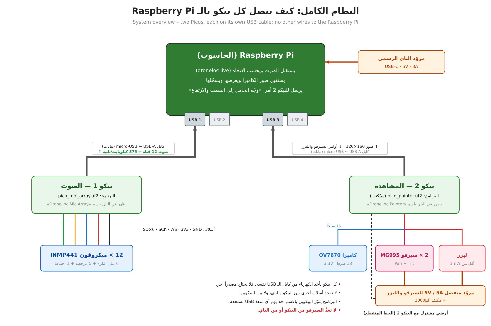
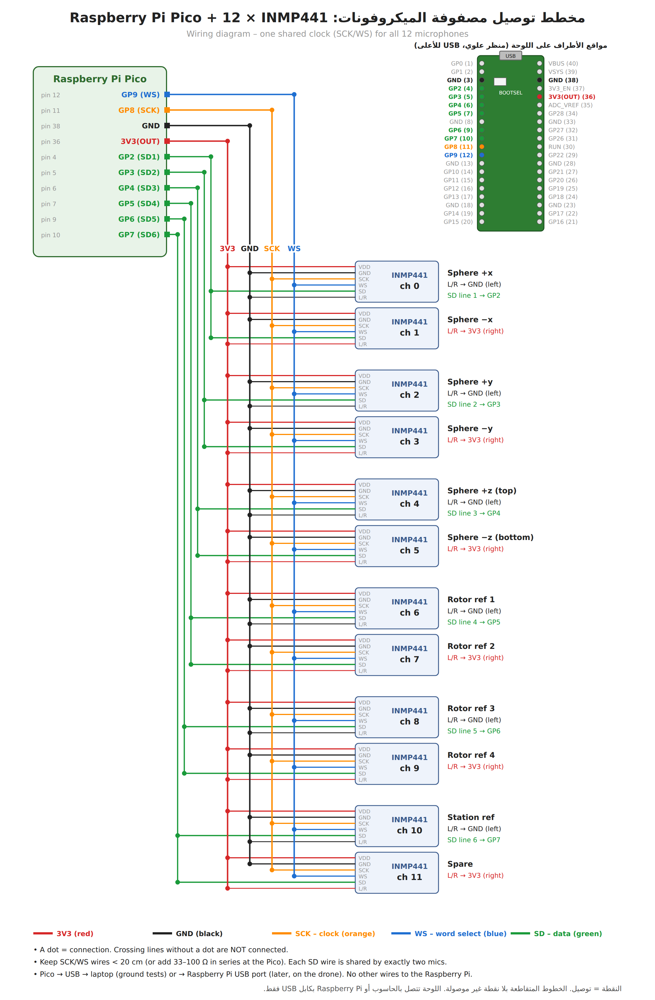
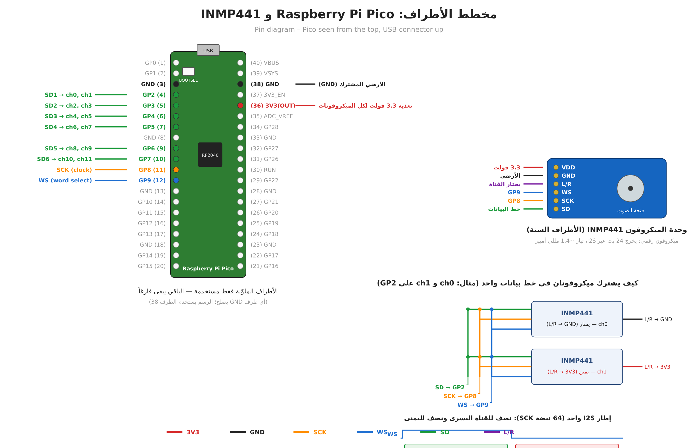
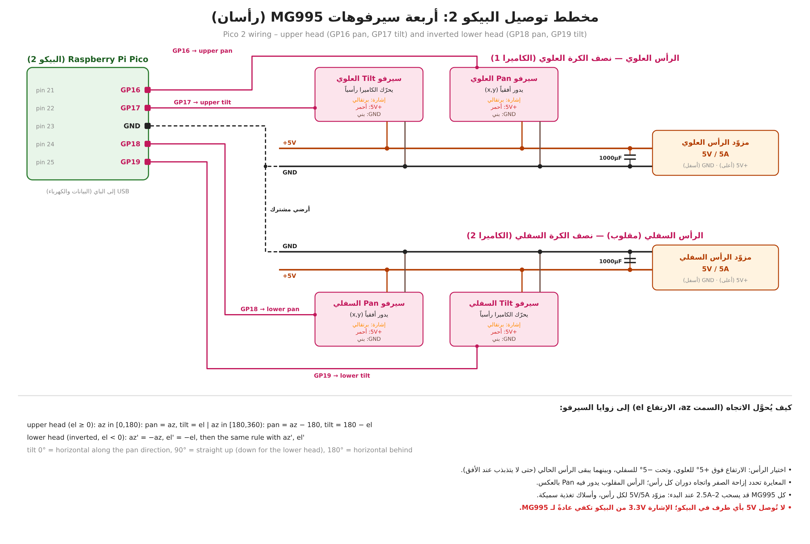
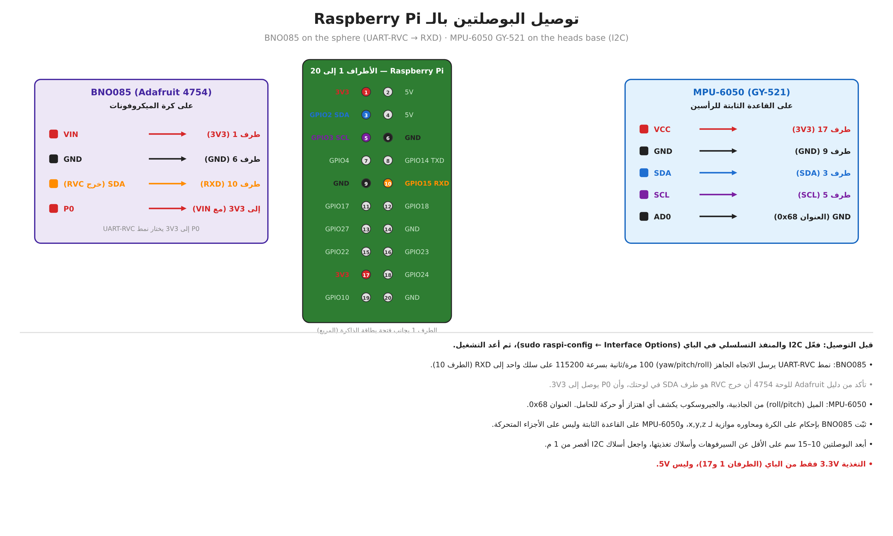

# Briefing for Claude Code on the Raspberry Pi

Acoustic drone localization: hardware bring-up of the microphone array, two USB cameras, two pan/tilt heads and two orientation sensors. Updated 19 November 2026; branch `main` (version 3.0.0). The user-facing step-by-step session plan (Arabic) is docs/reports/Pi_Session_Runbook_AR.docx. Figures carry Arabic labels; the text below describes them fully.

## 1. Read this first

You are helping Dr. Husham Saied (the user) bring up the hardware of an acoustic drone-localization project on a Raspberry Pi. The user prefers replies in Arabic (right-to-left text, commands in code blocks). Keep explanations short and practical: they build and wire the hardware themselves and paste terminal output back to you.

**Ground rules:**

- The software side is written and tested in simulation; **none of the firmware has run on real hardware yet**. Expect bring-up issues and debug them step by step, starting with two microphones.

- The journal submission is closed, so the code is no longer frozen; still note in the README any change that alters numerical results. Unpublished patent drawings stay out of this public repository (they are in the owner's private Google Drive).

- Keep the code Python 3.9 compatible and working on 32-bit ARM (the current Pi OS is armhf).

- Run python -m pytest tests after changes (25 tests; about 4 minutes on the Pi).

- Safety: servos on their own 5 V supplies (one per head), never from the Pico or the Pi; keep hands clear of the heads while they move.

## 2. Project and computer

### 2.1 What the project does

A six-microphone rigid sphere (160 mm diameter, microphones at ±x, ±y, ±z) estimates the 3D direction of a drone from its rotor sound, so that a battery-swap station can guide the drone in. The processing chain: reference subtraction (reference microphones near the rotors and the station machinery train a multichannel Wiener canceller in a target-free window), voiceprint (blade-passing frequency, BPF, and its harmonics), and the 3D sound meter (GCC-PHAT / SRP with rigid-sphere steering, range from the calibrated level, Kalman tracking).

Python package droneloc/; command line python -m droneloc {libraries,run,evaluate-array,coherence,dregon,sphere-geometry,live}.

### 2.2 The Raspberry Pi

| **Item**                  | **Value**                                                                                               |
|---------------------------|---------------------------------------------------------------------------------------------------------|
| Project folder            | /home/pi/Desktop/The Dron Project/code (quote it: the path has spaces)                                  |
| Virtual environment       | source .venv/bin/activate                                                                               |
| OS                        | Raspberry Pi OS, 32-bit userland (armhf) on a 64-bit kernel (uname -m = aarch64, getconf LONG_BIT = 32) |
| Python                    | 3.9.2                                                                                                   |
| System packages installed | libsndfile1 libopenblas-dev                                                                             |
| Python packages           | requirements.txt + pyserial; Pillow installed with pip install --only-binary=:all: pillow               |
| Git                       | git config pull.ff only is set                                                                          |
| Speed                     | About 10–20x slower than a laptop on every processing step                                              |

### 2.3 Updating the code on the Pi

Everything is on main (version 3.0.0); the working branches were merged and deleted on 19 November 2026. The Pi clone was made from the old branch, whose history was rewritten, so switch it to main once:

```bash
cd "/home/pi/Desktop/The Dron Project/code"
git fetch origin
git checkout -B main origin/main
source .venv/bin/activate
python -m pytest tests
\# later updates: git pull
```

Untracked files such as live.wav (a simulated test recording) are not affected. Do not re-add the removed submission files or the old docs/NEXT_SESSION.md.

## 3. Hardware architecture

Two Raspberry Pi Pico boards (RP2040) and two USB webcams, each on its own USB cable to the Raspberry Pi (assumed to be a Raspberry Pi 4: Picos on the two black USB 2 ports, cameras on the two blue USB 3 ports). There are no other wires between these devices and the Pi. Each Pico is powered by its USB cable; each pan/tilt head has its own 5 V supply whose ground is joined to the ground of Pico 2.



**Figure 1. System overview (labels in Arabic).**

|                  | **Pico 1 – audio**                                                          | **Pico 2 – servo controller**                                           |
|------------------|-----------------------------------------------------------------------------|-------------------------------------------------------------------------|
| Firmware         | hardware/pico_mic_array/pico_mic_array.uf2 (built, not yet run on hardware) | hardware/pico_pointer/pico_pointer.uf2 (built, not yet run on hardware) |
| USB product name | DroneLoc Mic Array                                                          | DroneLoc Pointer                                                        |
| To the Pi        | 12 audio channels, 15625 Hz, int16 (375 kB/s)                               | Short status replies                                                    |
| From the Pi      | Nothing (streams while the port is open, DTR set)                           | Pan/tilt angles for the two heads                                       |
| Attached         | 12 x INMP441 I2S microphones                                                | 4 x MG995 servos (upper and lower pan/tilt head)                        |

**Port detection:** droneloc.pico.find_port(product="DroneLoc Mic Array") picks the port by USB product name and falls back to the first Raspberry Pi vendor id (0x2E8A) port. Give Pico 2 a different product string so the two are never confused.

**Parts:** the user ordered the INMP441 microphones (expected around 1 November 2026) and a Raspberry Pi Pico (RP2040, without soldered headers: the 2 x 20 header strips must be soldered). For the visual check they use two Logitech Brio 100 USB webcams (they replaced an OV7670 camera module) on two pan/tilt heads with four MG995 servos; there is no laser for now. Brackets and servo supplies are still to be bought. An Adafruit BNO085 IMU (product 4754) was considered for a later phase (array orientation) and is not part of this bring-up.

## 4. Pico 1: the 12-microphone array

### 4.1 Wiring

All microphones share one bit clock (SCK) and one word select (WS) generated by the Pico, so the 12 channels are sample-synchronous (required: about 20 ppm clock skew between channels already breaks the reference canceller in simulation). Each data line (SD) carries two microphones; the L/R pin selects the slot (GND = left = even channel, 3V3 = right = odd channel). The microphone that is not in its slot leaves SD in high impedance.



**Figure 2. Wiring of Pico 1 with 12 INMP441 microphones (hardware/pico_mic_array/wiring.png).**



**Figure 3. Pico pinout with the used pins, INMP441 pins, and two microphones sharing one SD line.**

| **Pico pin** | **GPIO** | **Signal**     | **Connects to**                              |
|--------------|----------|----------------|----------------------------------------------|
| 4            | GP2      | SD1            | SD of channels 0, 1                          |
| 5            | GP3      | SD2            | SD of channels 2, 3                          |
| 6            | GP4      | SD3            | SD of channels 4, 5                          |
| 7            | GP5      | SD4            | SD of channels 6, 7                          |
| 9            | GP6      | SD5            | SD of channels 8, 9                          |
| 10           | GP7      | SD6            | SD of channels 10, 11                        |
| 11           | GP8      | SCK (2.0 MHz)  | SCK of all 12 microphones                    |
| 12           | GP9      | WS (31.25 kHz) | WS of all 12 microphones                     |
| 36           | 3V3(OUT) | 3.3 V          | VDD of all microphones; L/R of odd channels  |
| 38 (any GND) | GND      | Ground         | GND of all microphones; L/R of even channels |

| **Channel** | **Role**                      | **SD line** | **L/R** |
|-------------|-------------------------------|-------------|---------|
| 0           | Sphere +x                     | GP2         | GND     |
| 1           | Sphere −x                     | GP2         | 3V3     |
| 2           | Sphere +y                     | GP3         | GND     |
| 3           | Sphere −y                     | GP3         | 3V3     |
| 4           | Sphere +z (top)               | GP4         | GND     |
| 5           | Sphere −z (bottom)            | GP4         | 3V3     |
| 6           | Rotor reference 1             | GP5         | GND     |
| 7           | Rotor reference 2             | GP5         | 3V3     |
| 8           | Rotor reference 3             | GP6         | GND     |
| 9           | Rotor reference 4             | GP6         | 3V3     |
| 10          | Station (machinery) reference | GP7         | GND     |
| 11          | Spare                         | GP7         | 3V3     |

Geometry file of the sphere (channel order +x, −x, +y, −y, +z, −z; radius 80 mm): python -m droneloc sphere-geometry sphere.csv. Array frame: x forward, y left, z up; azimuth = atan2(y, x).

**Wiring rules:** SCK/WS wires shorter than 20 cm (else 33–100 Ω in series at the Pico); unplug USB while rewiring; never connect 5 V to a microphone; INMP441 draws about 1.4 mA, 12 of them about 17 mA from 3V3(OUT).

### 4.2 Firmware (hardware/pico_mic_array)

- System clock 128 MHz; one PIO state machine generates SCK (2.0 MHz) and WS by side-set (64 SCK per frame, 31250 frames/s); six PIO state machines sample the six SD lines on each rising SCK edge (7 of the 8 PIO state machines are used).

- Core 1: 24-bit samples, 79-tap half-band filter (stop band > 56 dB), decimation 2:1 to 15625 Hz, +12 dB gain (INMP441 −26 dBFS at 94 dB SPL becomes −14 dBFS; clipping near 108 dB SPL), int16, ring buffer of 2048 frames. Usable band up to about 6.9 kHz.

- Core 0: USB CDC packets of 64 frames x 12 channels: "MICA" \| u32 seq \| u32 dropped \| u16 nch \| u16 nframes \| u32 fs \| int16 data \| u16 checksum (checksum = sum of the int16 words mod 65536). droneloc/pico.py PacketReader resyncs on the magic, rejects bad checksums and zero-fills lost packets so channels stay aligned.

- LED (GP25): blinks once per second while waiting for the host; on or toggling while streaming. The Pico only streams while the serial port is open with DTR set.

- USB VID 0x2E8A, PID 0x000A, product "DroneLoc Mic Array". Rebuild: pico-sdk ≥ 2.0 + arm-none-eabi-gcc (mkdir build && cd build && cmake -DPICO_SDK_PATH=... .. && make).

### 4.3 Bring-up procedure

1.  Flash: hold BOOTSEL, plug in USB, release; a drive RPI-RP2 appears; cp hardware/pico_mic_array/pico_mic_array.uf2 /media/pi/RPI-RP2/.

2.  Check: LED blinks once per second; lsusb shows 2e8a:000a; /dev/ttyACM0 exists.

3.  Wire only channels 0 and 1 (GP2; L/R to GND and to 3V3) and run python experiments/record_pico.py --check.

4.  Expected: channels 0 and 1 about −70 to −55 dBFS in silence and −40 to −20 dBFS when speaking close by; unconnected channels about −90 or lower; "lost 0 bad 0".

5.  Add microphone pairs one SD line at a time, checking levels each time; then record: python experiments/record_pico.py --seconds 30 --out run01.wav.

6.  Synchronisation check: tap the sphere or clap at a known side; the channel facing the sound should lead (inspect run01.wav), and python -m droneloc evaluate-array with a loudspeaker at known directions should give small errors.

7.  Live: python -m droneloc live --refs 6,7,8,9,10 --cal 3 --bpf 105,200 --steering sphere --hop 0.5 --log live.csv (keep the target away during the 3 s calibration).

### 4.4 Troubleshooting

| **Symptom**                                         | **Likely cause / action**                                                                                                                                   |
|-----------------------------------------------------|-------------------------------------------------------------------------------------------------------------------------------------------------------------|
| "Pico not found"                                    | No Pico on USB, wrong firmware, or a charge-only cable. lsusb: 2e8a:0003 = still in BOOTSEL (copy the .uf2 again); no 2e8a at all = try another cable/port. |
| /dev/ttyACM0 exists but "Permission denied"         | User not in the dialout group: sudo usermod -aG dialout pi, then log out and in.                                                                            |
| A channel at about −90 dBFS                         | Microphone not powered, SD on the wrong GPIO, or both microphones of a pair on the same L/R level.                                                          |
| Both channels of a pair noisy / identical / garbage | L/R wrong (both on the same slot) – they fight on the shared SD line.                                                                                       |
| Clipping (near 0 dBFS) at normal sound levels       | Gain too high for the setup: reduce GAIN_SHIFT in main.c and rebuild.                                                                                       |
| "lost" or "dropped" counters grow                   | USB bandwidth / host load: direct USB port (no hub), close other programs.                                                                                  |
| Wrong directions, consistently mirrored or rotated  | Channel order or sphere axes do not match the geometry (channel 0 must face +x, etc.).                                                                      |

## 5. Live mode (software already written)

python -m droneloc live (droneloc/live.py) reads the Pico USB stream (or a WAV file cut into the same packets with --wav, paced like the real device with --realtime). It trains the reference canceller on the first --cal seconds, then every --hop seconds (default 0.25) estimates the direction from the last --window seconds (default 0.5): reference cancellation (time domain, 2048-sample STFT, with 2048 samples of history so its edges fall outside the window) → BPF estimate → GCC-PHAT cross-spectra → PhaseSRP with sphere steering. It prints time, level (dBFS), azimuth, elevation, peak power and BPF; --log writes a CSV.

| **Option**                  | **Meaning**                                                                    |
|-----------------------------|--------------------------------------------------------------------------------|
| --port                      | Serial port (default: the Pico named "DroneLoc Mic Array")                     |
| --wav / --realtime          | Replay a recording instead of the Pico                                         |
| --geometry / --array        | Geometry CSV and array channel indices (default: 160 mm sphere, channels 0–5)  |
| --refs 6,7,8,9,10 / --cal 3 | Reference channels and calibration time                                        |
| --bpf 105,200               | BPF search range (rotor comb); or --band lo,hi for a beacon / broadband source |
| --steering sphere           | Rigid-sphere steering instead of free field                                    |
| --window 0.5 / --hop 0.25   | Analysis window and time between estimates                                     |
| --seconds / --log           | Stop time and CSV log                                                          |

**Raspberry Pi performance** (32-bit OS, two reference channels, measured with python experiments/profile_live.py live.wav): 244 ms per estimate (reference cancellation 97, cross-spectra 66, cap phases 35, cap power 22, grid 16 ms), startup 3.0 s. With five references cancellation is slower, so start with --hop 0.5. If the computer falls behind, only the newest window is processed ("skipped N" in the output), so the delay stays bounded.

**Accuracy in simulation:** median error below 1° without machinery noise; with 80 dB station machinery all estimates after calibration within 3° (146° without the reference microphones). At 90–95 dB machinery the canceller (about 27 dB) is not enough.

**Tried and rejected:** cancelling directly in the GCC STFT domain without overlap-add resynthesis (145° error, as bad as no cancellation).

## 6. Pico 2, two pan/tilt heads, two USB cameras and the orientation sensors

Purpose: a visual and quantitative check of the acoustic direction estimate, and a tool to calibrate the array alignment. Each head carries a camera and points along the estimated direction; if the estimate is right, the sound source (a loudspeaker indoors, the drone outdoors) appears at the image centre, and its pixel offset gives the angular error in degrees. The upper head covers the upper hemisphere; the lower head, mounted upside down, covers the lower hemisphere. There is no laser in the current design.



**Figure 4. Pico 2 wiring: four MG995 servos in two heads, one 5 V / 5 A supply per head.**

### 6.1 Pin assignment (Pico 2)

| **Pico pin** | **GPIO** | **Signal**                           | **Notes**                                    |
|--------------|----------|--------------------------------------|----------------------------------------------|
| 21           | GP16     | Upper head – pan                     | Hardware PWM (slice 0A), 50 Hz               |
| 22           | GP17     | Upper head – tilt                    | Hardware PWM (slice 0B)                      |
| 24           | GP18     | Lower head – pan                     | Hardware PWM (slice 1A)                      |
| 25           | GP19     | Lower head – tilt                    | Hardware PWM (slice 1B)                      |
| 23           | GND      | Common ground                        | Joined to the GND of both 5 V servo supplies |
| USB          | —        | Data and power from the Raspberry Pi | Product string "DroneLoc Pointer"            |

**Power:** each head has its own 5 V / 5 A supply with a 1000 µF capacitor (an MG995 can draw 2–2.5 A when starting or stalled); thick power wires; never power servos from the Pico or the Raspberry Pi. Servo wire colours: signal orange, +5 V red, GND brown.

#### MG995 servos (chosen by the user because of the camera weight)

| **Property**  | **Typical value (check the seller page)**                                              | **Consequence**                                                                               |
|---------------|----------------------------------------------------------------------------------------|-----------------------------------------------------------------------------------------------|
| Supply        | 4.8–7.2 V                                                                              | Run at 5 V                                                                                    |
| Stall torque  | about 8.5 kg·cm at 4.8 V, about 10 kg·cm at 6 V                                        | Plenty for one webcam per head                                                                |
| Current       | a few hundred mA moving, up to about 2–2.5 A starting or stalled                       | 5 V / 5 A per head, 1000 µF capacitor                                                         |
| Speed         | about 0.2 s per 60°                                                                    | Rate-limit commands; a full sweep takes ~0.6 s                                                |
| Size / weight | about 40 x 20 x 43 mm, 55 g                                                            | Metal bracket for standard-size servos                                                        |
| Range         | nominally 180°, many units give less (about 120–170°)                                  | Measure the real range: the hemisphere mapping in 6.3 needs 180° on both axes                 |
| Signal        | 50 Hz PWM, about 500–2500 µs; analog servo with a noticeable dead band and some jitter | Calibrate the end points per servo; 3.3 V Pico signal usually works, else add a level shifter |

### 6.2 Pico 2 firmware (hardware/pico_pointer/, written 18 November 2026, not yet run on hardware)

- Built: hardware/pico_pointer/pico_pointer.uf2 (pico-sdk 2.1.1). USB CDC device, VID 0x2E8A, product string "DroneLoc Pointer". Host-side unit test of the command logic: cc -Itest test/test_main.c -o t && ./t in that folder.

- Four hardware PWM outputs at 50 Hz on GP16–GP19 (1 MHz counter, compare level = pulse width in µs). Channels: 0 upper pan, 1 upper tilt, 2 lower pan, 3 lower tilt.

- **Safety:** all channels released (no pulses) at power-up; default limits 1200–1800 µs until calibrated (absolute 500–2500); slew rate 300 µs/s; watchdog releases everything after 5 s without a command (P pings keep it alive).

- Commands (one per line; replies "OK ..." / "ERR ..."): ? status (5 lines), S <ch> <us>, A <ch> <deg> (0–180 over min..max), H <U\|L> <pan> <tilt>, X <ch\|\*> release, LIM <ch> <min> <max>, RATE <us_per_s>, T <s> watchdog (0 = off), P ping.

- Host side: droneloc/pointer.py (mapping, head selection, calibration JSON, serial client) and python -m droneloc pointer {status,servo,angle,point,release,init-cal} \[values\] \[--hold s\] \[--cal pointer_cal.json\]; live mode: --pointer \[--pointer-cal\] \[--range m\].

- **User report:** some servo test codes made servos spin 360° continuously. A positional 180° servo cannot do that, so those units are probably continuous-rotation MG995 variants (unusable for pointing) or damaged. The runbook asks the user to hand-test each servo unpowered first.

### 6.3 Directions to servo angles, and which head moves

Array frame: x forward, y left, z up; azimuth az = atan2(y, x) taken in \[0°, 360°), elevation el in \[−90°, 90°\]. Pan 0° points along +x; tilt 0° is horizontal along the pan direction, 90° straight up (straight down for the lower head), 180° horizontal in the opposite direction.

- Upper head (el ≥ 0): az in \[0°, 180°): pan = az, tilt = el; az in \[180°, 360°): pan = az − 180°, tilt = 180° − el (the tilt servo leans back over the top).

- Lower head (mounted upside down, i.e. rotated 180° about the x axis): az′ = −az (mod 360), el′ = −el, then the same rule with az′, el′. The calibration decides the real signs and offsets.

- Head selection with hysteresis: el > +5° → upper head, el < −5° → lower head, in between keep the head in use; park (or release) the idle head.

- Branch hysteresis: near az = 0° or 180° both branches point the same way but differ by a 180° pan swing; the branch in use is kept while the pan stays within 5° outside 0–180° (clipped). Parallax: with a range, the head aims at the point r away from the sphere, using the head position in the calibration file.

The live mode prints azimuth in (−180°, 180°\]; convert with az % 360. Each head gets its own calibration (zero offsets and the rotation between the array frame and the head frame), stored in a small JSON file.

### 6.4 The cameras: two Logitech Brio 100 (USB, on the Raspberry Pi)

- Standard UVC webcams, Full HD 1080p. Connect them to the two blue USB 3 ports of the Pi; the two Picos go on the black USB 2 ports. They appear as /dev/video\*; identify each camera by /dev/v4l/by-id/ (serial number) or by its USB port path in /dev/v4l/by-path/, not by the video number, which can change between boots.

- On the 32-bit Pi decode at most 1280x720 (or 640x480) MJPEG at 10–15 fps per camera, so that the audio processing keeps up. OpenCV: sudo apt install python3-opencv and a venv created with --system-site-packages, or pip install opencv-python-headless (piwheels).

- Field of view about 58° diagonal (check): at 1280x720 that is about 0.04° per pixel, much finer than the expected acoustic error. Measure degrees per pixel once with a target at a known angle.

- The built-in microphone of the Brio 100 is not used for localization (it runs on a different clock from the array).

- Mount: remove the monitor clip if possible to save weight; align the camera optical axis with the pan/tilt axes (boresight) and record the offset during calibration.

### 6.5 Host side still to write

1.  droneloc live --pointer exists (moves only when the change exceeds 2.5°, pings otherwise). Still to add: move only between listening windows, because four MG995 are loud; mount the heads at least 50 cm from the sphere.

2.  Viewer/recorder for both cameras: centre mark, az/el overlay, recording of frames and estimates with timestamps.

3.  Calibration per head: point at known loudspeaker positions, fit pan/tilt offsets, direction signs and the frame rotation; save to JSON.

4.  Error measurement: angular error from the pixel offset of the target to the image centre (simple marker or LED on the loudspeaker indoors; drone detection outdoors).

### 6.6 Shopping list for this part

| **Part**                                                       | **Qty**      | **Notes**                                              |
|----------------------------------------------------------------|--------------|--------------------------------------------------------|
| Metal pan/tilt bracket for standard-size servos (MG995/MG996R) | 2            | One per head                                           |
| MG995 servo (metal gears)                                      | 4 (+1 spare) | Chosen by the user; MG996R is the improved successor   |
| 5 V / 5 A supply and 1000 µF / 16 V capacitor                  | 2 each       | One per head                                           |
| Second Raspberry Pi Pico (RP2040)                              | 1            | Servo controller; keeps servo noise off the audio Pico |
| Logitech Brio 100 webcam                                       | 2            | Owned by the user                                      |
| Thick power wire, Dupont wires, terminal blocks                | —            | Servo power and signals                                |

### 6.7 Orientation sensors (python -m droneloc imu, droneloc/imu.py)

The user owns one BNO085 and, among others, a GY-521 (MPU-6050), GY-291 (ADXL345), GY-273 (HMC5883L), HW-290 (likely a GY-87: MPU-6050 + HMC5883L + BMP180) and an MLX90393. No new purchase.



**Figure 5. Orientation sensors on the Raspberry Pi header.**

| **Sensor**                                        | **Where**                                        | **Connection**                                                                               | **Gives**                                  |
|---------------------------------------------------|--------------------------------------------------|----------------------------------------------------------------------------------------------|--------------------------------------------|
| BNO085 (Adafruit 4754), UART-RVC mode (P0 to 3V3) | On the sphere, axes parallel to x, y, z          | VIN → pin 1 (3V3), GND → pin 6, SDA (RVC output) → pin 10 (GPIO15 RXD); /dev/serial0, 115200 | Yaw, pitch, roll at 100 Hz (fused)         |
| MPU-6050 (GY-521)                                 | Fixed base of the two heads, not on moving parts | VCC → pin 17 (3V3), GND → pin 9, SDA → pin 3, SCL → pin 5, AD0 → GND (0x68)                  | Roll, pitch from gravity; gyro shows bumps |

- No compass on the heads: the MG995 magnets and currents would distort it; the heads' yaw comes from the camera calibration and the MPU-6050 watches for tilt or bumps.

- RVC frame: 0xAA 0xAA, index, yaw/pitch/roll int16 \[0.01°\], ax/ay/az int16 \[mg\], 3 reserved, checksum = sum of bytes 2..17 mod 256 (parse_rvc, tested). Pi set-up: raspi-config → I2C on, serial port hardware on, login shell off; pip install smbus2.

- Verify against the Adafruit 4754 guide that the RVC output is the SDA pin and that P0 selects RVC before wiring.

## 7. Open items, in order

1.  Bring up Pico 1 with two microphones, then all twelve; verify synchronisation and channel order (section 4.3).

2.  Real-array test with a loudspeaker at known directions (evaluate-array) and in live mode; record the timing on the Pi with experiments/profile_live.py using five references.

3.  Bring up Pico 2 (one servo at a time, measured limits into pointer_cal.json), the cameras and the two orientation sensors, following docs/reports/Pi_Session_Runbook_AR.docx; then calibrate the heads and write the camera viewer and error measurement (6.5).

4.  If the Pi is too slow with five references: speed up reference cancellation and cross-spectra in the live path only (keep the published path unchanged).

5.  Kalman tracking (direction and range) in live mode.

6.  Use the sensor readings in the pointer: rotate directions from the sphere frame (BNO085) to the heads frame (calibrated yaw + MPU-6050 tilt).
