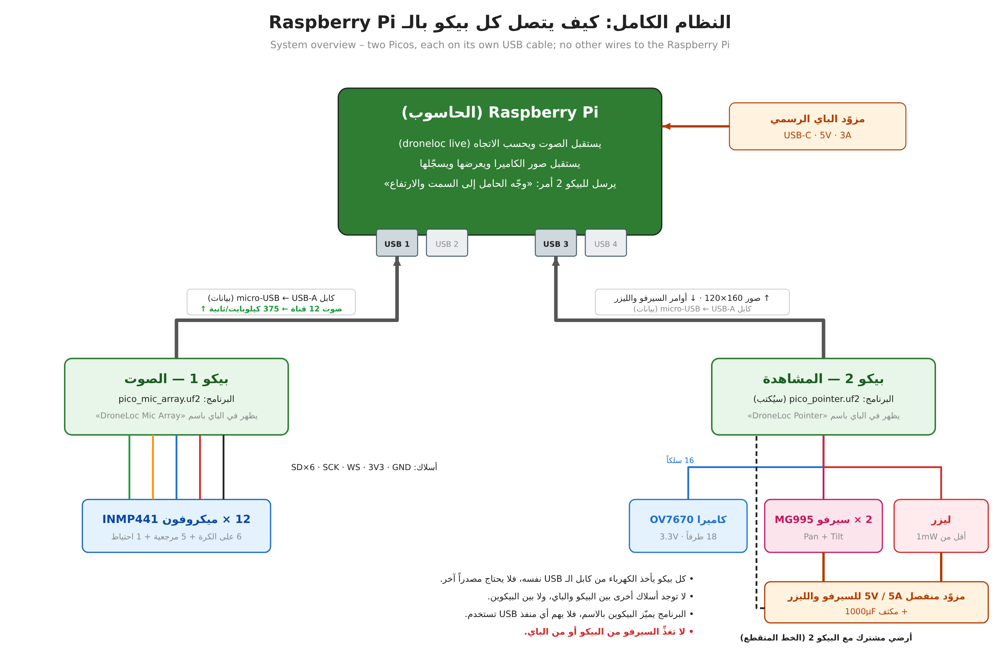
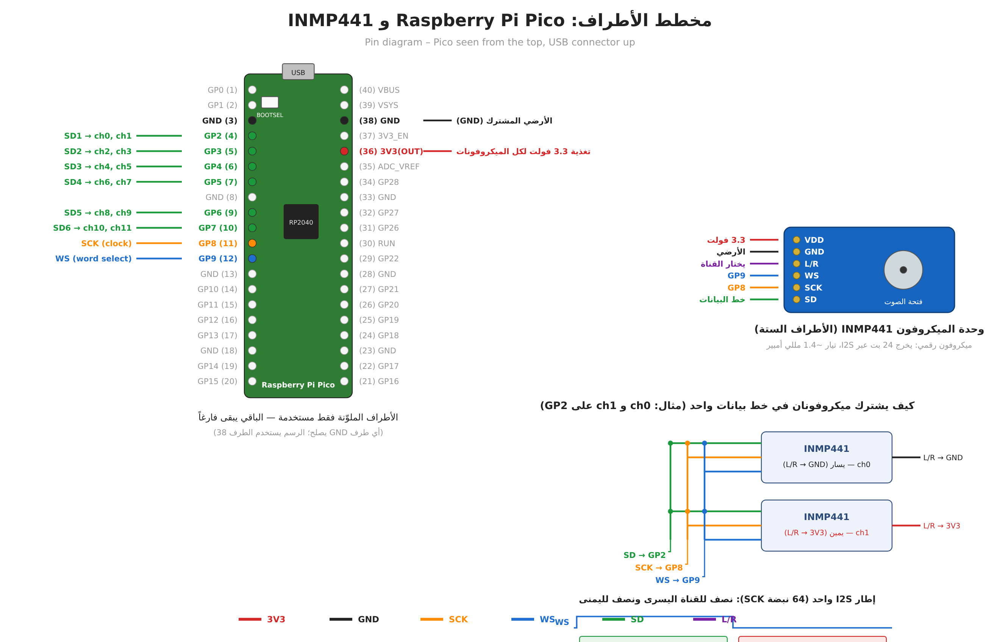
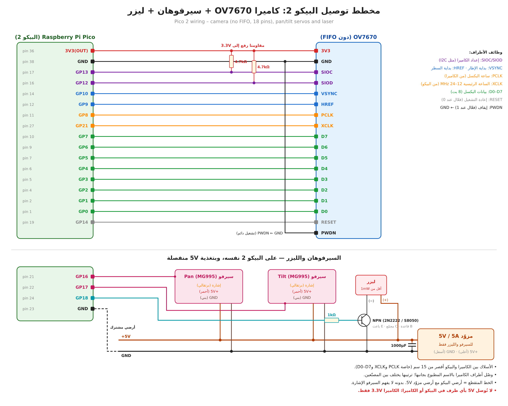

# Briefing for Claude Code on the Raspberry Pi

Acoustic drone localization: hardware bring-up of the microphone array, camera and pan/tilt pointer. Prepared 29 October 2026; branch `claude/epic-ride-9fqd2p`. Figures carry Arabic labels; the text below describes them fully.

## 1. Read this first

You are helping Dr. Husham Saied (the user) bring up the hardware of an acoustic drone-localization project on a Raspberry Pi. The user prefers replies in Arabic (right-to-left text, commands in code blocks). Keep explanations short and practical: they build and wire the hardware themselves and paste terminal output back to you.

**Ground rules:**

- The software side is written and tested in simulation; **none of the firmware has run on real hardware yet**. Expect bring-up issues and debug them step by step, starting with two microphones.

- Do not change the exact estimation path that produced the published results (main = release 2.1.0, Zenodo DOI 10.5281/zenodo.23151340). Speed-ups for the Pi go behind options such as PhaseSRP(fast=True), which only the live mode uses.

- Keep the code Python 3.9 compatible and working on 32-bit ARM (the current Pi OS is armhf).

- Run python -m pytest tests after changes (22 tests; about 4 minutes on the Pi).

- Safety: laser below 1 mW (class 2), indoor bench tests only, never towards people, aircraft or drones in flight; servos on their own 5 V supply.

## 2. Project and computer

### 2.1 What the project does

A six-microphone rigid sphere (160 mm diameter, microphones at ±x, ±y, ±z) estimates the 3D direction of a drone from its rotor sound, so that a battery-swap station can guide the drone in. The processing chain: reference subtraction (reference microphones near the rotors and the station machinery train a multichannel Wiener canceller in a target-free window), voiceprint (blade-passing frequency, BPF, and its harmonics), and the 3D sound meter (GCC-PHAT / SRP with rigid-sphere steering, range from the calibrated level, Kalman tracking).

Python package droneloc/; command line python -m droneloc {libraries,run,evaluate-array,coherence,dregon,sphere-geometry,live}.

### 2.2 The Raspberry Pi

| **Item**                  | **Value**                                                                                               |
|---------------------------|---------------------------------------------------------------------------------------------------------|
| Project folder            | /home/pi/Desktop/The Dron Project/code (quote it: the path has spaces)                                  |
| Virtual environment       | source .venv/bin/activate                                                                               |
| OS                        | Raspberry Pi OS, 32-bit userland (armhf) on a 64-bit kernel (uname -m = aarch64, getconf LONG_BIT = 32) |
| Python                    | 3.9.2                                                                                                   |
| System packages installed | libsndfile1 libopenblas-dev                                                                             |
| Python packages           | requirements.txt + pyserial; Pillow installed with pip install --only-binary=:all: pillow               |
| Git                       | git config pull.ff only is set                                                                          |
| Speed                     | About 10–20x slower than a laptop on every processing step                                              |

### 2.3 Updating the code on the Pi (history was rewritten)

On 24 October 2026 the branch history on GitHub was rewritten (the journal submission files were removed from the public history). A plain git pull therefore fails on the Pi. Update with:

```bash
cd "/home/pi/Desktop/The Dron Project/code"
git fetch origin
git reset --hard origin/claude/epic-ride-9fqd2p
source .venv/bin/activate
python -m pytest tests
```

Untracked files such as live.wav (a simulated test recording) are not affected. Do not re-add the removed submission files or the old docs/NEXT_SESSION.md.

## 3. Hardware architecture

Two Raspberry Pi Pico boards (RP2040), each on its own USB cable to the Raspberry Pi. There are no other wires between the Picos and the Pi, or between the two Picos. Each Pico is powered by its USB cable; the servos and the laser have a separate 5 V supply whose ground is joined to the ground of Pico 2.



**Figure 1. System overview (labels in Arabic).**

|                  | **Pico 1 – audio**                                                          | **Pico 2 – camera and pointer**                                   |
|------------------|-----------------------------------------------------------------------------|-------------------------------------------------------------------|
| Firmware         | hardware/pico_mic_array/pico_mic_array.uf2 (built, not yet run on hardware) | **Not written yet (section 6)**                                   |
| USB product name | DroneLoc Mic Array                                                          | DroneLoc Pointer (planned)                                        |
| To the Pi        | 12 audio channels, 15625 Hz, int16 (375 kB/s)                               | Camera frames, 160x120 grayscale, ~10–15 fps                      |
| From the Pi      | Nothing (streams while the port is open, DTR set)                           | Pan/tilt angles, laser on/off                                     |
| Attached         | 12 x INMP441 I2S microphones                                                | OV7670 camera (no FIFO, 18 pins), 2 x MG995 servos, laser < 1 mW |

**Port detection:** droneloc.pico.find_port(product="DroneLoc Mic Array") picks the port by USB product name and falls back to the first Raspberry Pi vendor id (0x2E8A) port. Give Pico 2 a different product string so the two are never confused.

**Parts:** the user ordered the INMP441 microphones (expected around 1 November 2026) and a Raspberry Pi Pico (RP2040, without soldered headers: the 2 x 20 header strips must be soldered). They own an OV7670 (no-FIFO, 18-pin) camera. The user chose MG995 servos (the camera and laser add weight); the pan/tilt bracket and laser are still to be bought. An Adafruit BNO085 IMU (product 4754) was considered for a later phase (array orientation) and is not part of this bring-up.

## 4. Pico 1: the 12-microphone array

### 4.1 Wiring

All microphones share one bit clock (SCK) and one word select (WS) generated by the Pico, so the 12 channels are sample-synchronous (required: about 20 ppm clock skew between channels already breaks the reference canceller in simulation). Each data line (SD) carries two microphones; the L/R pin selects the slot (GND = left = even channel, 3V3 = right = odd channel). The microphone that is not in its slot leaves SD in high impedance.


**Figure 2. Wiring of Pico 1 with 12 INMP441 microphones (hardware/pico_mic_array/wiring.png).**



**Figure 3. Pico pinout with the used pins, INMP441 pins, and two microphones sharing one SD line.**

| **Pico pin** | **GPIO** | **Signal**     | **Connects to**                              |
|--------------|----------|----------------|----------------------------------------------|
| 4            | GP2      | SD1            | SD of channels 0, 1                          |
| 5            | GP3      | SD2            | SD of channels 2, 3                          |
| 6            | GP4      | SD3            | SD of channels 4, 5                          |
| 7            | GP5      | SD4            | SD of channels 6, 7                          |
| 9            | GP6      | SD5            | SD of channels 8, 9                          |
| 10           | GP7      | SD6            | SD of channels 10, 11                        |
| 11           | GP8      | SCK (2.0 MHz)  | SCK of all 12 microphones                    |
| 12           | GP9      | WS (31.25 kHz) | WS of all 12 microphones                     |
| 36           | 3V3(OUT) | 3.3 V          | VDD of all microphones; L/R of odd channels  |
| 38 (any GND) | GND      | Ground         | GND of all microphones; L/R of even channels |

| **Channel** | **Role**                      | **SD line** | **L/R** |
|-------------|-------------------------------|-------------|---------|
| 0           | Sphere +x                     | GP2         | GND     |
| 1           | Sphere −x                     | GP2         | 3V3     |
| 2           | Sphere +y                     | GP3         | GND     |
| 3           | Sphere −y                     | GP3         | 3V3     |
| 4           | Sphere +z (top)               | GP4         | GND     |
| 5           | Sphere −z (bottom)            | GP4         | 3V3     |
| 6           | Rotor reference 1             | GP5         | GND     |
| 7           | Rotor reference 2             | GP5         | 3V3     |
| 8           | Rotor reference 3             | GP6         | GND     |
| 9           | Rotor reference 4             | GP6         | 3V3     |
| 10          | Station (machinery) reference | GP7         | GND     |
| 11          | Spare                         | GP7         | 3V3     |

Geometry file of the sphere (channel order +x, −x, +y, −y, +z, −z; radius 80 mm): python -m droneloc sphere-geometry sphere.csv. Array frame: x forward, y left, z up; azimuth = atan2(y, x).

**Wiring rules:** SCK/WS wires shorter than 20 cm (else 33–100 Ω in series at the Pico); unplug USB while rewiring; never connect 5 V to a microphone; INMP441 draws about 1.4 mA, 12 of them about 17 mA from 3V3(OUT).

### 4.2 Firmware (hardware/pico_mic_array)

- System clock 128 MHz; one PIO state machine generates SCK (2.0 MHz) and WS by side-set (64 SCK per frame, 31250 frames/s); six PIO state machines sample the six SD lines on each rising SCK edge (7 of the 8 PIO state machines are used).

- Core 1: 24-bit samples, 79-tap half-band filter (stop band > 56 dB), decimation 2:1 to 15625 Hz, +12 dB gain (INMP441 −26 dBFS at 94 dB SPL becomes −14 dBFS; clipping near 108 dB SPL), int16, ring buffer of 2048 frames. Usable band up to about 6.9 kHz.

- Core 0: USB CDC packets of 64 frames x 12 channels: "MICA" \| u32 seq \| u32 dropped \| u16 nch \| u16 nframes \| u32 fs \| int16 data \| u16 checksum (checksum = sum of the int16 words mod 65536). droneloc/pico.py PacketReader resyncs on the magic, rejects bad checksums and zero-fills lost packets so channels stay aligned.

- LED (GP25): blinks once per second while waiting for the host; on or toggling while streaming. The Pico only streams while the serial port is open with DTR set.

- USB VID 0x2E8A, PID 0x000A, product "DroneLoc Mic Array". Rebuild: pico-sdk ≥ 2.0 + arm-none-eabi-gcc (mkdir build && cd build && cmake -DPICO_SDK_PATH=... .. && make).

### 4.3 Bring-up procedure

1.  Flash: hold BOOTSEL, plug in USB, release; a drive RPI-RP2 appears; cp hardware/pico_mic_array/pico_mic_array.uf2 /media/pi/RPI-RP2/.

2.  Check: LED blinks once per second; lsusb shows 2e8a:000a; /dev/ttyACM0 exists.

3.  Wire only channels 0 and 1 (GP2; L/R to GND and to 3V3) and run python experiments/record_pico.py --check.

4.  Expected: channels 0 and 1 about −70 to −55 dBFS in silence and −40 to −20 dBFS when speaking close by; unconnected channels about −90 or lower; "lost 0 bad 0".

5.  Add microphone pairs one SD line at a time, checking levels each time; then record: python experiments/record_pico.py --seconds 30 --out run01.wav.

6.  Synchronisation check: tap the sphere or clap at a known side; the channel facing the sound should lead (inspect run01.wav), and python -m droneloc evaluate-array with a loudspeaker at known directions should give small errors.

7.  Live: python -m droneloc live --refs 6,7,8,9,10 --cal 3 --bpf 105,200 --steering sphere --hop 0.5 --log live.csv (keep the target away during the 3 s calibration).

### 4.4 Troubleshooting

| **Symptom**                                         | **Likely cause / action**                                                                                                                                   |
|-----------------------------------------------------|-------------------------------------------------------------------------------------------------------------------------------------------------------------|
| "Pico not found"                                    | No Pico on USB, wrong firmware, or a charge-only cable. lsusb: 2e8a:0003 = still in BOOTSEL (copy the .uf2 again); no 2e8a at all = try another cable/port. |
| /dev/ttyACM0 exists but "Permission denied"         | User not in the dialout group: sudo usermod -aG dialout pi, then log out and in.                                                                            |
| A channel at about −90 dBFS                         | Microphone not powered, SD on the wrong GPIO, or both microphones of a pair on the same L/R level.                                                          |
| Both channels of a pair noisy / identical / garbage | L/R wrong (both on the same slot) – they fight on the shared SD line.                                                                                       |
| Clipping (near 0 dBFS) at normal sound levels       | Gain too high for the setup: reduce GAIN_SHIFT in main.c and rebuild.                                                                                       |
| "lost" or "dropped" counters grow                   | USB bandwidth / host load: direct USB port (no hub), close other programs.                                                                                  |
| Wrong directions, consistently mirrored or rotated  | Channel order or sphere axes do not match the geometry (channel 0 must face +x, etc.).                                                                      |

## 5. Live mode (software already written)

python -m droneloc live (droneloc/live.py) reads the Pico USB stream (or a WAV file cut into the same packets with --wav, paced like the real device with --realtime). It trains the reference canceller on the first --cal seconds, then every --hop seconds (default 0.25) estimates the direction from the last --window seconds (default 0.5): reference cancellation (time domain, 2048-sample STFT, with 2048 samples of history so its edges fall outside the window) → BPF estimate → GCC-PHAT cross-spectra → PhaseSRP with sphere steering. It prints time, level (dBFS), azimuth, elevation, peak power and BPF; --log writes a CSV.

| **Option**                  | **Meaning**                                                                    |
|-----------------------------|--------------------------------------------------------------------------------|
| --port                      | Serial port (default: the Pico named "DroneLoc Mic Array")                     |
| --wav / --realtime          | Replay a recording instead of the Pico                                         |
| --geometry / --array        | Geometry CSV and array channel indices (default: 160 mm sphere, channels 0–5)  |
| --refs 6,7,8,9,10 / --cal 3 | Reference channels and calibration time                                        |
| --bpf 105,200               | BPF search range (rotor comb); or --band lo,hi for a beacon / broadband source |
| --steering sphere           | Rigid-sphere steering instead of free field                                    |
| --window 0.5 / --hop 0.25   | Analysis window and time between estimates                                     |
| --seconds / --log           | Stop time and CSV log                                                          |

**Raspberry Pi performance** (32-bit OS, two reference channels, measured with python experiments/profile_live.py live.wav): 244 ms per estimate (reference cancellation 97, cross-spectra 66, cap phases 35, cap power 22, grid 16 ms), startup 3.0 s. With five references cancellation is slower, so start with --hop 0.5. If the computer falls behind, only the newest window is processed ("skipped N" in the output), so the delay stays bounded.

**Accuracy in simulation:** median error below 1° without machinery noise; with 80 dB station machinery all estimates after calibration within 3° (146° without the reference microphones). At 90–95 dB machinery the canceller (about 27 dB) is not enough.

**Tried and rejected:** cancelling directly in the GCC STFT domain without overlap-add resynthesis (145° error, as bad as no cancellation).

## 6. Pico 2: camera and pan/tilt laser pointer (to be implemented)

Purpose: visual and quantitative check of the acoustic direction estimate, and a tool to calibrate the array alignment. The pan/tilt head points along the estimated direction; indoors a laser dot shows where the system thinks a loudspeaker is; a camera on the same head shows whether the source is at the image centre, and the pixel offset gives the error in degrees. Outdoors the laser is useless (the dot is invisible against the sky) and must not be aimed at aircraft or drones: use the camera only.



**Figure 4. Pico 2 wiring: OV7670 (no FIFO), pan/tilt servos and laser.**

### 6.1 Pin assignment

| **Pico pin**            | **GPIO**       | **Signal**           | **Notes**                                                                     |
|-------------------------|----------------|----------------------|-------------------------------------------------------------------------------|
| 1, 2, 4, 5, 6, 7, 9, 10 | GP0–GP7        | OV7670 D0–D7         | Consecutive GPIOs, read by one PIO program                                    |
| 11                      | GP8            | PCLK (camera → Pico) | Pixel clock                                                                   |
| 12                      | GP9            | HREF                 | Line valid                                                                    |
| 14                      | GP10           | VSYNC                | Frame start                                                                   |
| 27                      | GP21           | XCLK (Pico → camera) | Clock output (GPOUT0), 12–24 MHz                                              |
| 16                      | GP12           | SIOD (SCCB data)     | 4.7 kΩ pull-up to 3.3 V; I2C0 SDA                                             |
| 17                      | GP13           | SIOC (SCCB clock)    | 4.7 kΩ pull-up to 3.3 V; I2C0 SCL                                             |
| 19                      | GP14           | RESET (active low)   |                                                                               |
| —                       | GND            | PWDN (active high)   | Tied to GND: always on                                                        |
| 36 / 38                 | 3V3(OUT) / GND | Camera 3V3 / GND     | The camera is 3.3 V only                                                      |
| 21                      | GP16           | Pan servo signal     | Hardware PWM, 50 Hz                                                           |
| 22                      | GP17           | Tilt servo signal    | Hardware PWM, 50 Hz                                                           |
| 24                      | GP18           | Laser enable         | 1 kΩ to the base of an NPN (2N2222/S8050); laser (−) to collector, (+) to 5 V |
| 23                      | GND            | Common ground        | Joined to the GND of the 5 V servo supply                                     |

**Power:** servos and laser from a separate 5 V / 5 A supply with a 1000 µF capacitor across it (two MG995 can draw 2–3 A each when starting or stalled); never from the Pico or the Raspberry Pi. Camera wires shorter than 15 cm (PCLK, XCLK, D0–D7). Connect camera pins by the names printed on the board: the physical order varies between makers.

#### MG995 servos (chosen by the user because of the camera and laser weight)

| **Property**  | **Typical value (check the seller page)**                                              | **Consequence**                                                                               |
|---------------|----------------------------------------------------------------------------------------|-----------------------------------------------------------------------------------------------|
| Supply        | 4.8–7.2 V                                                                              | Run at 5 V together with the laser (one 5 V / 5 A supply)                                     |
| Stall torque  | about 8.5 kg·cm at 4.8 V, about 10 kg·cm at 6 V                                        | Plenty for a small camera and laser                                                           |
| Current       | a few hundred mA moving, up to about 2–2.5 A starting or stalled                       | 5 A supply, 1000 µF capacitor, thick power wires                                              |
| Speed         | about 0.2 s per 60°                                                                    | Rate-limit commands; a full sweep takes ~0.6 s                                                |
| Size / weight | about 40 x 20 x 43 mm, 55 g                                                            | Standard-size bracket, not the SG90/MG90S kit                                                 |
| Range         | nominally 180°, many units give less (about 120–170°)                                  | Measure the real range: the hemisphere mapping in 6.3 needs 180° on both axes                 |
| Signal        | 50 Hz PWM, about 500–2500 µs; analog servo with a noticeable dead band and some jitter | Calibrate the end points per servo; 3.3 V Pico signal usually works, else add a level shifter |

### 6.2 Firmware to write (hardware/pico_pointer/)

- USB CDC device, VID 0x2E8A, product string "DroneLoc Pointer".

- Camera: XCLK from GPOUT0 on GP21 (e.g. ~12 MHz); configure over SCCB (I2C, 7-bit address 0x21) using a known-good OV7670 register table from an open-source project, QQVGA 160x120 YUV422; a PIO program waits for VSYNC/HREF and samples D0–D7 on rising PCLK; DMA into a frame buffer; keep only the Y bytes (grayscale, 19.2 kB per frame).

- Frame packets to the host, e.g. "CAMF" \| u32 seq \| u16 w \| u16 h \| u8 format \| data \| u16 checksum, resynchronising on the magic like the audio packets.

- Commands from the host as text lines, e.g. P <pan_deg> <tilt_deg>, L 0\|1 (laser), ? (status). Reply in a separate packet type so binary frames and replies do not mix.

- Servos: hardware PWM 50 Hz, pulse about 500–2500 µs for 0–180° (calibrate the end points per servo); limit the slew rate; laser off at start-up and whenever no command arrived for a few seconds.

### 6.3 Covering the upper hemisphere with two 180° servos

Pan 0° points along the array +x axis; tilt 0° is horizontal along the pan direction, 90° straight up, 180° horizontal in the opposite direction. With azimuth az taken in \[0°, 360°) and elevation el in \[0°, 90°\]:

- az in \[0°, 180°): pan = az, tilt = el

- az in \[180°, 360°): pan = az − 180°, tilt = 180° − el (the tilt servo leans back over the top)

The live mode prints azimuth in (−180°, 180°\]; convert with az % 360. Directions below the horizon cannot be reached; clamp el at 0°.

### 6.4 Host side to write

1.  droneloc live --pointer: send the (smoothed, rate-limited) direction to Pico 2; move only when the change exceeds 2–3°, and preferably between listening windows, because the servos themselves make noise that the array hears. Mount the pan/tilt head at least 50 cm from the sphere (MG995 gears are loud).

2.  Viewer/recorder: show the camera image with a centre mark, overlay az/el, record frames and estimates with timestamps.

3.  Calibration: point at known loudspeaker positions, fit the pan/tilt zero offsets and the rotation between the array frame and the pan/tilt frame; save to a small JSON file used by --pointer.

4.  Error measurement: angular error from the pixel offset of the target to the image centre (degrees per pixel from the lens field of view, measured once with a target at a known angle).

### 6.5 Shopping list for this part

| **Part**                                                        | **Qty**      | **Notes**                                                        |
|-----------------------------------------------------------------|--------------|------------------------------------------------------------------|
| Pan/tilt bracket for standard-size servos (MG995/MG996R), metal | 1            | Must carry camera + laser                                        |
| MG995 servo (metal gears)                                       | 2 (+1 spare) | Chosen by the user; MG996R is the improved successor             |
| Red laser module 650 nm, < 1 mW                                | 1            | Indoor tests only                                                |
| NPN transistor 2N2222 or S8050, 1 kΩ resistor                   | 1 each       | Laser switch                                                     |
| 5 V / 5 A supply and 1000 µF / 16 V capacitor                   | 1 each       | Servo and laser power (not 6 V: the laser module is 3–5 V)       |
| 2 x 4.7 kΩ resistors                                            | 2            | SCCB pull-ups (many blue OV7670 boards lack them)                |
| Second Raspberry Pi Pico (RP2040)                               | 1            | Keeps camera and servos off the audio Pico                       |
| Short female–female Dupont wires                                | ~25          | Camera to Pico, under 15 cm                                      |
| Optional: USB webcam                                            | 1            | Better than OV7670 for outdoor tests; plugs into the Pi directly |

## 7. Open items, in order

1.  Bring up Pico 1 with two microphones, then all twelve; verify synchronisation and channel order (section 4.3).

2.  Real-array test with a loudspeaker at known directions (evaluate-array) and in live mode; record the timing on the Pi with experiments/profile_live.py using five references.

3.  Write the Pico 2 firmware and the host side (section 6), test indoors with a loudspeaker and the laser.

4.  If the Pi is too slow with five references: speed up reference cancellation and cross-spectra in the live path only (keep the published path unchanged).

5.  Kalman tracking (direction and range) in live mode.

6.  Later: BNO085 IMU on the Pi (I2C; note the known BNO08x clock-stretching issue on the Raspberry Pi) to convert directions to earth axes.

7.  Merge claude/epic-ride-9fqd2p into main via a pull request when the user asks.
