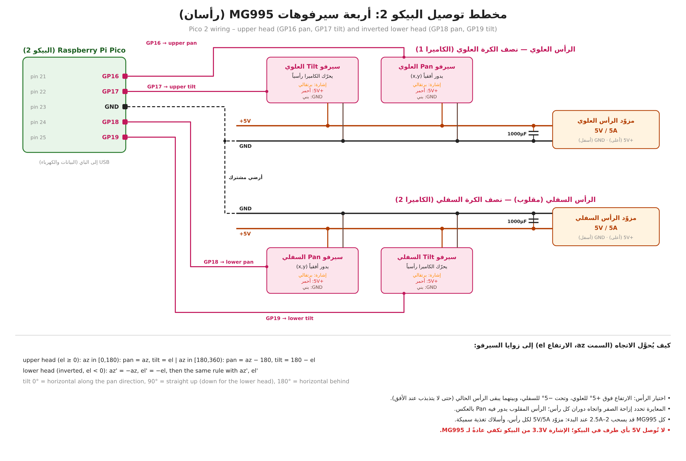

# Pico pointer: two pan/tilt camera heads (4 servos)

A second Raspberry Pi Pico (RP2040) drives the two camera heads from text commands over
USB. The cameras themselves (2 x Logitech Brio 100) plug into the Raspberry Pi directly.

> Status: compiles (pico-sdk 2.1.1) and the command logic passes a host-side unit test,
> but it has **not yet run on real hardware**. Start with one servo, horn removed.



| Pico pin | GPIO | Channel | Servo |
|---|---|---|---|
| 21 | GP16 | 0 | upper head, pan |
| 22 | GP17 | 1 | upper head, tilt |
| 24 | GP18 | 2 | lower head (upside down), pan |
| 25 | GP19 | 3 | lower head, tilt |
| 23 | GND | — | ground of both 5 V servo supplies |

Each head has its own 5 V / 5 A supply with a 1000 µF capacitor; never power servos from the
Pico or the Raspberry Pi. Only positional (180°) servos work: a continuous-rotation (360°)
MG995 cannot hold an angle. Turn each horn by hand, unpowered, first: it must stop at two ends.

## Safety built into the firmware

* At power-up no channel gets pulses: the servos are limp and never move on their own.
* Limits per channel, default 1200..1800 µs (about ±55°) until measured (absolute 500..2500).
* Slew rate 300 µs/s; all channels released after 5 s without a command (`P` keeps it alive).

## Flash and use

Hold BOOTSEL, plug in, release; copy `pico_pointer.uf2` to the `RPI-RP2` drive. The LED blinks
once per second while all servos are released and stays on while one is driven.

```
python -m droneloc pointer init-cal                  # pointer_cal.json with the safe limits
python -m droneloc pointer status
python -m droneloc pointer servo 0 1500 --hold 5     # one channel to 1500 us for 5 s
python -m droneloc pointer point 30 20 --hold 5      # aim along az 30, el 20 (array frame)
python -m droneloc pointer release
python -m droneloc live ... --pointer --range 3      # follow the acoustic estimate
```

Commands (one per line, replies `OK ...` or `ERR ...`): `?`, `S <ch> <us>`, `A <ch> <deg>`,
`H <U|L> <pan> <tilt>`, `X <ch|*>`, `LIM <ch> <min> <max>`, `RATE <us_per_s>`, `T <s>`, `P`.

## Build and test

```
mkdir build && cd build && cmake -DPICO_SDK_PATH=/path/to/pico-sdk .. && make
cc -Itest test/test_main.c -o t && ./t               # host-side test of the command logic
```
